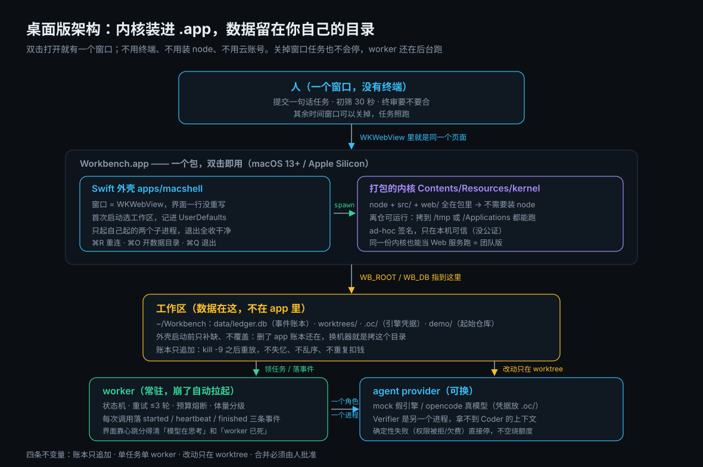
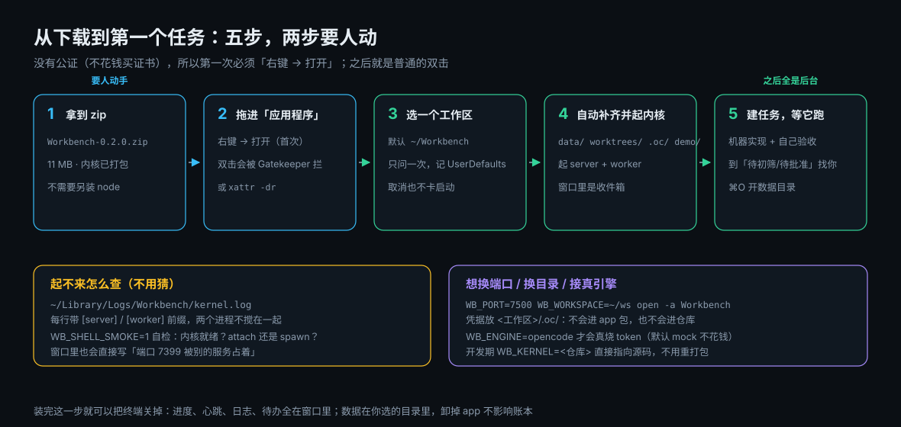
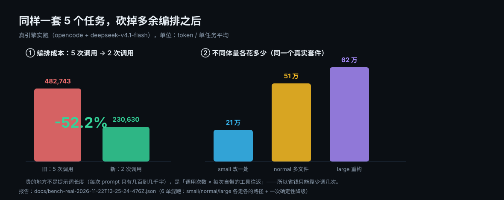
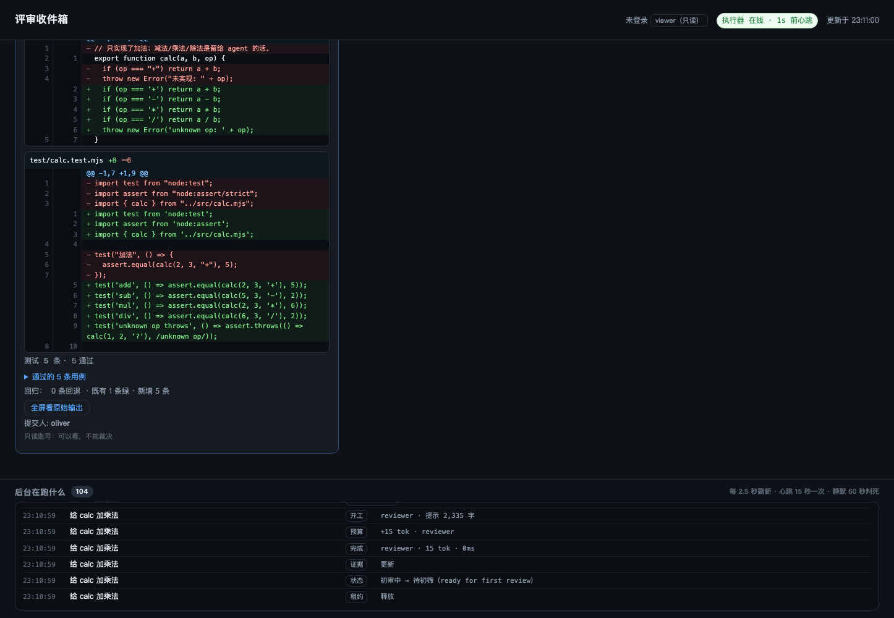
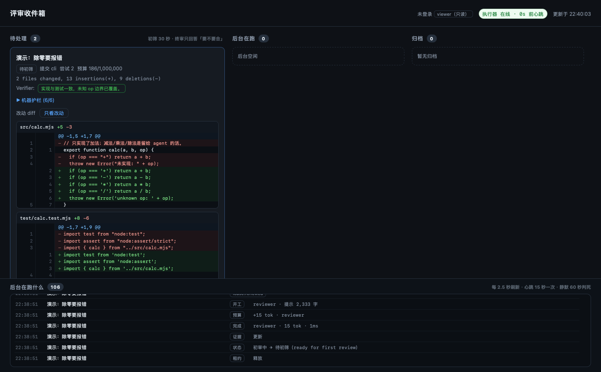
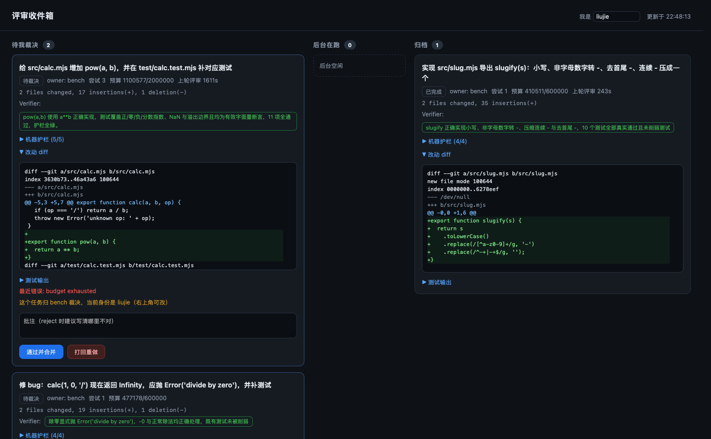
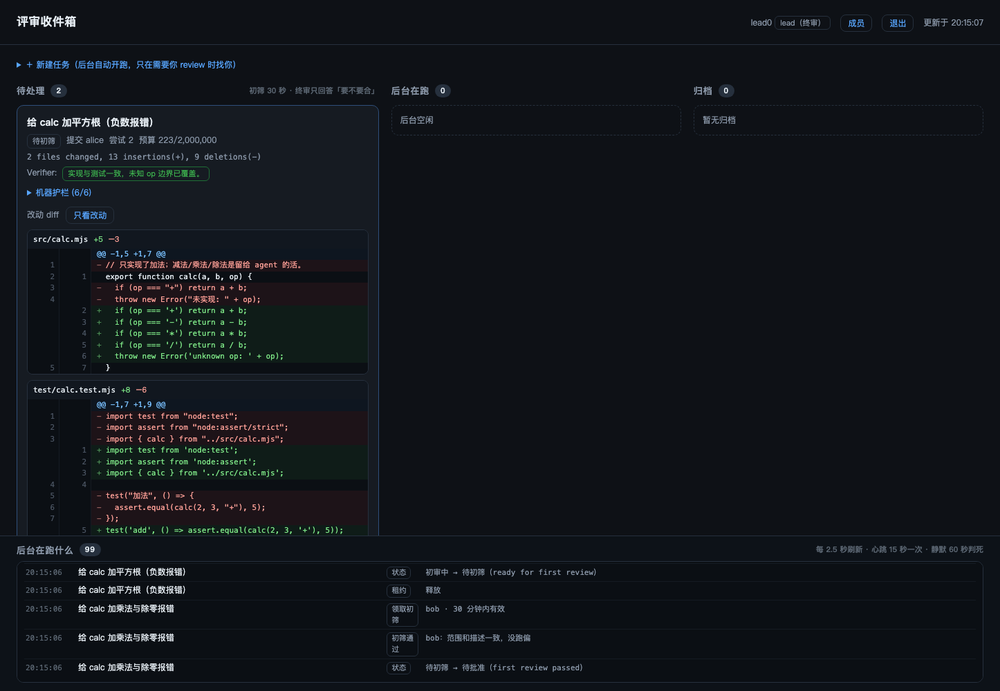
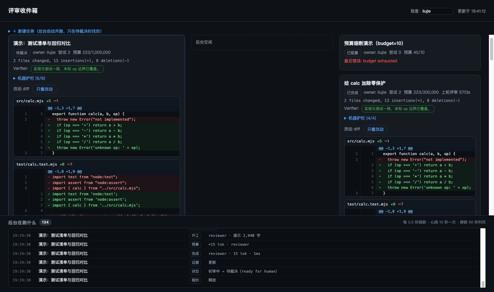
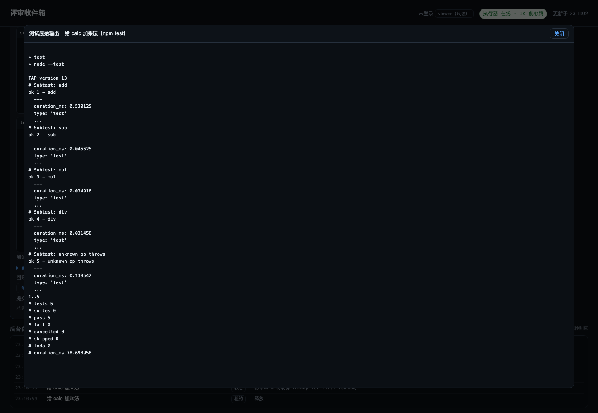
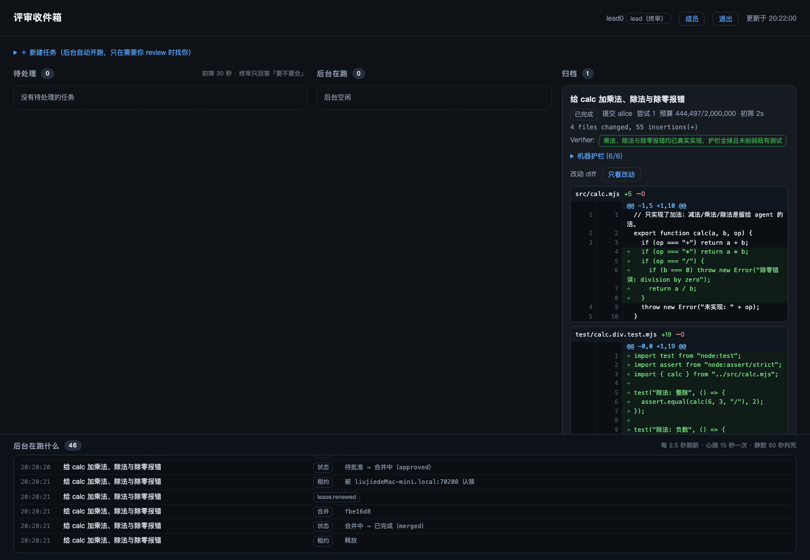

# 工作台 · Workbench（macOS 桌面版）

**一个「AI 团队分工写代码、人只负责 review」的后台编程执行器 —— 打成一个 .app，双击就能用。**

你提交一句话任务 → 后台自动拆解、写代码、跑真测试、独立复核 → 只把两个不可逆的时刻推到你面前：

1. **这件事做对了吗**（初筛，30 秒）
2. **要不要合**（终审，一句话）

其余全部自动重试、自动升级、自动归档、自动合并 —— 人不是值班员，是签字的人。

内核（node + src + web）**打包在 app 里**：不用装 node、不用开终端、不用云账号；账本、worktree、凭据都在你自己选的目录里，卸载 app 不影响数据。

`macOS 13+ / Apple Silicon` · `MIT` · `npm test` 77 项全过 · 默认 `mock` 引擎零成本 · 发布物 11 MB

> 仓库分工：这里只有 **macOS 桌面版**（Swift 外壳 + 打包内核）。Web 版（一台机器当 runner、多人浏览器访问）在 [noOne-Oliver/workbenchweb](https://github.com/noOne-Oliver/workbenchweb)，两边**不共享任何文件**，内核思路同源。

---

### 目录

[为什么需要它](#一为什么需要它) ·
[一张图看懂](#二一张图看懂它怎么跑) ·
[六个好处](#三六个好处每条都有实测数字) ·
[界面](#四界面长什么样) ·
[快速部署](#五快速部署) ·
[实测数字](#六实测数字真引擎不粉饰) ·
[人做什么](#七人到底要做什么) ·
[命令与环境变量](#八命令与环境变量) ·
[关键实现](#九深入几个关键实现) ·
[安全边界](#十安全边界别踩) ·
[不做什么](#十一它不做什么故意的) ·
[目录结构](#十二目录)

---

## 一、为什么需要它

AI 写代码的工具已经很多了，但**能无人值守跑一天、还能双击就用的很少**。大多数工具在你关掉终端的那一刻就失效了，或者要求你先装 node、配 key、把代码传到别人的服务器上。它们缺的不是模型能力，是下面这些东西：

| 常见的崩法 | 为什么会崩 | 这里的做法 | 你怎么亲眼确认 |
| --- | --- | --- | --- |
| 重启后「任务去哪了」 | 状态存在内存/进程里 | **事件账本**只追加，`tasks` 只是物化投影，重启从事件重放（`src/core/ledger.mjs`） | `kill -9` 后再跑，事件流出现 `attempt.resumed`，不重复烧重试额度 |
| 「测试全绿」但其实没改对 | 只信模型自评、只跑一遍测试 | **四道确定性护栏**：真跑测试、比对用例/断言数、查同义反复、diff 规模 + **回归基线**（`src/runner/guards.mjs`） | 注入一条恒真断言，第一轮必被打回，第二轮才过 |
| 人在旁边当值班员 | 只有「实现中」一个状态，看不出是模型在想还是进程已死 | **活动流**：每次 agent 调用落 `agent.started / heartbeat / finished`，界面常驻「coder 正在跑 · 已 1m23s」 | 静默超时那句话自动变红「⚠ 90s 无事件，worker 可能已停」 |
| 工具要终端、要 node、要云账号 | 分发形态决定了「只有工程师能用」 | **内核装进 .app**：node + src/ + web/ 全在包内，拷到 /tmp 也能跑（`apps/macshell/build.sh`） | `npm run verify:package` 把 app 拷到临时目录，不带仓库也能跑完一单 |
| 「这是谁批的？」 | 共享口令，谁都能批任何事 | **一人一号** + 三角色权限矩阵 + 两段评审（`src/core/permissions.mjs`） | 打回不写理由直接 400；member 点批准回 403 |
| 一晚上烧掉一个月预算 | 没有预算概念，重试无上限 | **预算熔断** + 进实现前留验证余量 + **体量分级**少调几次（`src/core/sizing.mjs`） | `--budget 10` 入队，跑一轮即 `blocked`，不再花 token |

一句话：**它把「不可信的部分」（模型写的代码）四道确定性检查围起来，把「不可逆的部分」（合并）留给人。**

---

## 二、一张图看懂它怎么跑



四条不变量，缺一条就会退化成值班员：

- **账本只追加** —— 任何状态都能从事件重算，进程崩了不等于事实丢了。
- **单任务单 worker** —— 靠租约，不靠「大家注意别抢」。
- **改动只发生在 worktree** —— 每个任务一个独立工作树，主仓库在被批准前不动。
- **合并必须由人批准** —— 机器可以证明「测试过了」，证明不了「这是你要的东西」。

### 从下载到第一个任务：五步，两步要人动



### 状态机（人只看得到两个闸门）


只有 `awaiting_review` 和 `awaiting_approval` 会停住等人（`blocked` 是「机器认输了，等人捞」）。
其余状态之间的每一次失败，都走同一条路：**带证据打回 → 重置 worktree → 重做**，最多 3 轮（`WB_MAX_ATTEMPTS`）。

一个人用的时候两关可以自己过（账本记 `self_approved` 并标红）；团队用时把 member 和 lead 分开，规则就自动生效。

---

## 三、六个好处（每条都有实测数字）

### 1) 人的时间被压到「读结论」这一步

卡片上直接给：按文件分组的 diff（双列行号、可只看改动）、**真跑过的测试清单**、六项护栏逐条结论、独立 Verifier 的裁决与上抛问题。真引擎整单实测：**初筛 2 秒 + 终审 2 秒**（任务 `t_mwrszckr0xwnk`，44.4 万 token、111 秒机器时间、护栏 6/6）。

「人只回答要不要合」不是口号，是界面设计：初筛只问三个问题（做的是不是这件事 / 范围能否接受 / 有没有遗留），终审只问一个（合不合）。

### 2) 假绿真的抓得住，不靠模型自觉

「测试跑绿 ≠ 改对了」。三条真实抓到的例子，全部下沉成**确定性检查**（模型没注意到也照抓）：

| 作弊手法 | 长什么样 | 谁抓的 |
| --- | --- | --- |
| 削弱测试 | 删测试文件、用例 4→1、断言 6→3 | `no_test_weakening` |
| 同义反复 | 实现是 `return Math.pow(a,b)`，测试写 `assert.equal(pow(2,.5), Math.pow(2,.5))` | `no_tautological_test` |
| 顺手改坏别人 | 原来能过的 4 条用例现在挂了 | `no_regression`（把 base 提交的树展开到临时目录，用同一条命令再跑一遍） |

假绿会被自动打回，重试到上限才升级给人。而重试这件事本身踩过两个坑、都堵上了：**不喂证据＝无脑重试**（现在把失败护栏 id + 证据原文 + 上一轮 diff 写进 coder 提示词），**不重置 worktree＝假装重试**（第二次之前 `git reset --hard` 回基线，否则 coder 看到上一轮代码会产出逐字节相同的 diff，白烧一整轮 token）。

### 3) 崩了自己回来，不靠人守着

- **任务级**：`kill -9` 后重启，从断点续跑，事件流出现 `attempt.resumed`（不重复计算重试次数）。
- **进程级**：`up` 起的是「被看护的 worker」，崩了按 1s→2s→4s…封顶 30s 退避自动拉起，跑稳 60s 计数清零（`src/core/supervisor.mjs`）。
- **僵尸进程**：外壳注入 `WB_PARENT_PID`，`kill -9` app 后内核自己收工，不会留下占着端口的孤儿（这条是打包之后真踩到的，见「关键实现」）。
- **卡死兜底**：认领到状态机不认识的状态 → 落 `run.stalled` 证据 + 转 `blocked`；连续 3 轮认领但状态/花费都没变也停到 `blocked`。绝不空转。

> 这条是真实事故换来的：一个旧 worker 认领了新状态 `awaiting_approval` 不认识，两小时空转写满 17GB 事件、86,864,540 条，最后 V8 自己 abort。现在「跑着旧代码」会直接在界面徽章上变红。

### 4) 成本减半，而且可预期



| 做法 | 效果 |
| --- | --- |
| **体量分级**：小改动跳过 lead/architect/reviewer，只花 coder + verifier 两次调用 | 同一套 5 单基准：平均 **482,743 → 230,630 token（−52.2%）**，机器时间 121 秒 → 49 秒 |
| **预算熔断**：超预算立刻 `blocked`，不再花一个 token | `--budget 10` 入队当场停 |
| **验证余量**：进实现前检查余量（默认留 25% 或 15 万） | 避免「写完实现、没钱验证」把钱和活一起扔掉 |
| **确定性分类**：体量由规则判（高危词 / 文件数 / 标题长度），不让模型自己声明 | 跑错了就是代码错了，跑完自动对账角色序列 |

真实开销量级（6 单混跑实测）：**small 约 21 万；normal 42~61 万；large 62 万 token**，平均一单约 126 秒机器时间。

### 5) 全过程看得见

状态徽章只告诉你「实现中」，分不清「模型在思考」和「worker 已死」——那又变成值班员。所以每次 agent 调用都落三条事件（开工 / 15 秒心跳 / 收工），界面底部常驻一条活动流，卡片上还有一句「**coder** 正在跑 · 已 1m23s」。



执行器本身也有心跳（每 5 秒写 `data/worker.json`，`/api/health` 免登录读），标题栏常驻「执行器 在线 · Ns 前心跳」，超过 20 秒变红「任务不会推进」。



### 6) 双击即用，数据在你自己盘上

这一条是桌面版存在的理由：

- **不装 node**：`Contents/Resources/kernel/` 里带着 node 二进制、`src/`、`web/`。把 app 拷到 `/tmp`、拷到 `/Applications`，甚至仓库已经不在了，它照样能跑完一单（`npm run verify:package` 每一轮都在验这件事）。
- **不传云**：任务、代码、diff、提示词、模型凭据都只在这台机器上；真引擎走的也是你自己填的 endpoint。
- **不丢数据**：账本和 worktree 在工作区（默认 `~/Workbench`），删掉 app 只是删掉 40 MB 的程序，账本还在；换机器就是把这个目录拷过去。
- **不留孤儿**：退出时 `SIGTERM` → 等 3 秒 → `SIGKILL`，worker 先收、server 后收，只收自己起的进程；app 被 `kill -9` 时内核自己发现 ppid 变了会退出。

代价也说清楚：**ad-hoc 签名、没有公证**，所以第一次打开必须右键 → 打开，而且这个包只在本机可信（详见「安全边界」）。

---

## 四、界面长什么样











> 界面和 Web 版是同一个页面（`web/index.html`），外壳只负责「装窗口 + 起两个子进程」，一行 UI 没重写。

---

## 五、快速部署

### 路径 A：下载安装（2 分钟，推荐先走这条）

**[下载 Workbench-0.2.0.zip](https://github.com/noOne-Oliver/workbench/releases/latest)** · 11 MB · macOS 13+ / Apple Silicon

```bash
# 想校验完整性的话（发布页上也贴了同一条）
shasum -a 256 ~/Downloads/Workbench-0.2.0.zip
# ddaf261ebc4e440a6bb50f0cc2ceedbf13b31887cdd395b49604e6f2b5ed41a2
```

1. 解压，把 `Workbench.app` 拖进「应用程序」。
2. 第一次必须**右键 → 打开**（没有苹果公证，双击会被 Gatekeeper 拦住）。命令行等价：`xattr -dr com.apple.quarantine /Applications/Workbench.app`
3. 选一个工作区目录（默认 `~/Workbench`，可以新建）。它会自己补 `data/ worktrees/ .oc/ demo/`、起内核，窗口里就是收件箱。

之后每次双击就行。它不会再问工作区（记在 `UserDefaults` 的 `workspace` 键），想换用 `WB_WORKSPACE=~/other open -a Workbench`。

### 路径 B：自己构建（有源码 + Command Line Tools）

```bash
bash apps/macshell/build.sh     # → dist/Workbench.app（swiftc 编外壳 + 拷内核 + ad-hoc 签名 + 自校验）
npm run package:mac             # → dist/Workbench-0.2.0.zip（有 hdiutil 时同时出 .dmg）
npm run verify:package          # 六断言，约 40 秒
```

只要 Command Line Tools 里的 `swiftc`（实测 Swift 6.4.2，不需要完整 Xcode）和一个 `node >= 22.5`（`WB_NODE` 可指定官方静态版）。

`verify:package` 判的不是「进程起来了」，而是六件具体的事：

```text
states=queued → verifying → awaiting_review
SIGTERM：端口已关闭
SIGKILL：3.0 秒后内核自己收工，没留孤儿
watchdog：52873 被杀 → 52878 接管（1s 前心跳）
PASS 离仓可运行 / 工作区正确 / worker 真跑 / SIGTERM 干净 / kill -9 无孤儿 / worker 崩了自愈
```

### 路径 C：不装 app，直接跑内核（服务器 / CI）

同一份代码不带壳也能跑，浏览器打开 `http://127.0.0.1:7317` 就是收件箱：

```bash
node src/cli.mjs workspace --dir ~/Workbench   # 建工作区（幂等）
WB_ROOT=~/Workbench node src/cli.mjs up        # 起 server + 看护着的 worker
```

### 接真引擎（可选，会花 token）

默认 `mock` 是确定性假引擎，只验证链路、不花钱。要真写代码，把凭据放进**工作区**（不进 app 包、不进仓库）：

```bash
# 1) 凭据放工作区，外壳启动时会注入 WB_OC_HOME=<工作区>/.oc
cp -r /path/to/oc-home/. ~/Workbench/.oc/     # 里面应有 opencode.json / provider.env / node_modules
chmod 600 ~/Workbench/.oc/private/provider.env

# 2) 体检：几秒钟给结论，不会挂在那儿
WB_OC_HOME=~/Workbench/.oc WB_ENGINE=opencode WB_MODEL=<provider/model> \
  node scripts/engine-smoke.mjs "只回复两个字 OK"

# 3) 带真引擎启动（预算按单任务给，真任务约 20~60 万 token）
WB_ENGINE=opencode WB_MODEL=<provider/model> WB_BUDGET=1000000 \
  WB_WORKSPACE=~/Workbench open -a Workbench
```

### 部署检查清单（装完照着走一遍，三分钟）

- [ ] 右键打开后窗口里是**三栏收件箱**（不是错误页，也不是白屏）
- [ ] 标题栏是「执行器 在线 · Ns 前心跳」（变红说明 worker 没在跑）
- [ ] 新建一个任务，看它自己从 `queued` 走到 `awaiting_review`（mock 约 3 秒）
- [ ] ⌘O 能打开 `<工作区>/data`，里面确实有 `ledger.db`
- [ ] `kill -9` 掉 worker 之后 4 秒内心跳恢复（看护生效）
- [ ] `kill -9` 掉 app 本体后 20 秒内端口关闭、没有残留进程（`npm run verify:package` 在验这条）
- [ ] 换真引擎后先跑**一单**，确认护栏全绿、token 在预算内，再放开给人用

### 装不上 / 起不来：先看这张表

日志永远在 `~/Library/Logs/Workbench/kernel.log`（`[server]` / `[worker]` 前缀分行，两个进程不搅在一起；目录不可写会退到 `$TMPDIR/Workbench/kernel.log` 并在日志里注明）。

| 现象 | 原因 | 解法 |
| --- | --- | --- |
| 双击「无法验证开发者」 | ad-hoc 签名，没公证 | 右键 → 打开；或 `xattr -dr com.apple.quarantine /Applications/Workbench.app` |
| 启动即崩，日志有 `dyld: Library not loaded: @rpath/libnode.127.dylib` | 打包时没带上 node 的 `@rpath` 依赖 | 用 `build.sh`（会按 `otool -L` 自动 `cp -L`）；或 `WB_NODE=` 指官方静态 node |
| 换了机器 / `brew upgrade node` 之后打不开 | 包里的 node 还依赖同机 `/opt/homebrew/opt/*` | 在目标机重跑 `build.sh`；要真正单文件分发得换静态 node 或 SEA |
| 窗口里写「端口 7399 已被其他服务占用，但它不是工作台内核」 | 别的程序占了这个端口 | `WB_PORT=7500 open -a Workbench` |
| 窗口空白，或连上了上次的内核但不动 | 上次 `kill -9` 留下的孤儿内核还占着端口 | 现在内核会自己收工（`WB_PARENT_PID`）；旧包手动 kill 掉再 ⌘R |
| 任务一直排队 | 只有 server 没有 worker（或 worker 崩了） | 外壳两个都起；看 `kernel.log` 里有没有 `[worker]` 行 |
| 首次启动没弹选目录、落在意料外的地方 | 之前选过，记在 `UserDefaults` | `WB_WORKSPACE=<目录> open -a Workbench`，或 `defaults delete local.workbench.shell workspace` |

---

## 六、实测数字（真引擎，不粉饰）

配置：opencode + `gptagent/deepseek-v4.1-flash`，同一套任务、同一台 M 系列 Mac。

### ① 真引擎整单（两段评审跑到底）

| 指标 | 值 |
| --- | --- |
| 任务 | `t_mwrszckr0xwnk`「给 calc 加乘法、除法与除零报错」 |
| 终态 | `done`，attempts=1（一次过） |
| token | 444,497 / 2,000,000 |
| 墙钟 | 111 秒（实现 + 验证 + 两段人工 + 合并） |
| 护栏 | 6/6 全绿（11 条用例真跑过，无回归、无削弱、无同义反复） |
| 改动 | 4 files changed, 55 insertions(+) |
| 初筛 / 终审 | 2s / 2s |
| 合并提交 | `fbe16d8 wb: merge 给 calc 加乘法、除法与除零报错` |

### ② 砍编排前后（同一套 5 单）

| 任务 | 旧：5 次调用 | 新：2 次调用 | 省 |
| --- | --- | --- | --- |
| slugify | 412,934 | 212,643 | 48.5% |
| median | 438,804 | 212,420 | 51.6% |
| range-bug | 463,427 | 238,872 | 48.5% |
| clamp | 466,648 | 264,167 | 43.4% |
| truncate | 631,901 | 225,049 | 64.4% |
| **平均** | **482,743** | **230,630** | **52.2%** |

5/5 仍一次过，护栏 6/6，合并后 main 上 27 个用例全绿；机器段 103~155 秒 → 39~57 秒。

### ③ small / normal / large 混跑 + 一次确定性降级

| 任务 | 体量 | 角色序列 | 尝试 | token | 机器秒 |
| --- | --- | --- | --- | --- | --- |
| slugify | small | coder → verifier | 1 | 210,118 | 48 |
| median | small | coder → verifier | 1 | 212,781 | 46 |
| merge-utils | normal | lead → coder → verifier → reviewer | 1 | 417,776 | 97 |
| truncate-long | normal | lead → coder → verifier → reviewer | 1 | 611,112 | 172 |
| refactor-range | large | lead → architect → coder → verifier → reviewer | 1 | 622,392 | 186 |
| fastpath-retry | small | coder → verifier →（被抓）→ lead → coder → verifier → reviewer | 2 | 829,423 | 205 |
| **合计** | — | 6/6 完成 | — | **2,903,602** | 墙钟 755 秒 |

### ④ 打包进 app 之后（同一份内核，行为不变）

| 指标 | 值 |
| --- | --- |
| 环境 | `Workbench.app` 拷到 `/tmp`，工作区 `/tmp/wb-real-ws`，`WB_ENGINE=opencode` |
| 任务 | 「实现乘法、除法与除零报错」，budget 2,000,000 |
| 结果 | `awaiting_review`，attempts=1，**409,738 token**，约 100 秒 |
| 护栏 | 全绿；Verifier 结论「乘法/除法/除零报错均正确实现，9 项测试真实通过」 |
| 改动 | 3 files changed, 46 insertions(+) |

**怎么读这些数（别读成「问题解决了」）**：

1. 一次过率 100% 只说明这些单在模型能力范围内，**不代表稳定**；失败率要拿「需求本身模糊」的活去跑才有意义。
2. 省钱来自「少调三次」，不是「调得更便宜」——单次调用仍是 6~17 万 token（harness + 工具往返 + 推理），继续压只能继续减次数。
3. 人工耗时 1~2 秒是**脚本代劳的下限**；真人读一单约 4 秒。真正该量化的是「证据包够不够判断」，这还没做。
4. 快路径把方案责任推给了 coder：没有上游拆解，它得一次想清接口形状。需求模糊的小改动跳过拆解可能反而多跑一轮（一轮 ≈ 21 万），所以这条规则该按**初筛打回率**持续校准。

复现：`npm run bench:real -- --fresh --tasks 6`（约 13 分钟、约 290 万 token）。报告都落在 `docs/bench-real-*.json` 与 `docs/real-review-*.json`。

---

## 七、人到底要做什么

| 环节 | 谁做 | 花多久 | 输出 |
| --- | --- | --- | --- |
| 提交任务 | 任何人 | 20 秒 | 一句话标题 + 目标仓库 + 预算 |
| 机器干活 | 后台 | 1~3 分钟 | diff / 测试清单 / 护栏 / Verifier 裁决 |
| 初筛 | 领取的人 | 30 秒 | 过，或打回 + 理由 |
| 终审 | lead（或自己） | 10 秒 | 合（合并），或打回 + 理由 |

三条铁律（写进 SOP，也写进代码）：

1. **Verifier ≠ Coder 的同一实例** —— 每个角色一次独立的进程调用，不给 coder 的内心独白；角色分离靠进程隔离，不靠提示词自觉。
2. **Agent 只上抛证据裁决不了的事** —— Verifier 自己判内容（同义反复、边界、非 ASCII 分隔符都是它主动上抛的）。
3. **人只回答「要不要合」，不回答「怎么写」** —— 想改写法就写一句打回理由，系统会带着它重做。

---

## 八、命令与环境变量

### 命令

```bash
# —— 桌面版 ——
npm run build:mac                  # 编外壳 + 打包内核 + ad-hoc 签名 → dist/Workbench.app
npm run package:mac                # → dist/Workbench-<版本>.zip（+ .dmg）
npm run verify:package             # 六断言复验打包产物（约 40 秒）
npm run icon:mac                   # 从 docs 里的原图重生成 AppIcon.icns（需要 python3 + Pillow）
open -a "$PWD/dist/Workbench.app"  # 跑起来

# —— 内核（不带壳也能用）——
node src/cli.mjs workspace --dir ~/Workbench     # 建工作区（幂等）
node src/cli.mjs init                            # 建库 + 建 demo 仓库
node src/cli.mjs enqueue --title "..." --repo <dir> [--owner <name>] [--budget 1000000]
node src/cli.mjs status [--id <task>]            # 任务与事件流
node src/cli.mjs rebuild                         # 从事件全量重建投影（自愈）
node src/cli.mjs run [--once] [--worker host:pid]# 跑 worker
node src/cli.mjs serve [--port 7317]             # 只起审阅服务
node src/cli.mjs up                              # 起整套（server + 看护着的 worker）
node src/cli.mjs user add|passwd|role|disable|enable|list

# —— 文档与演示 ——
npm run docs:diagrams              # 重生成 docs/arch.svg · install.svg · flow.svg · cost.svg
npm run shots                      # 重生成界面截图（需要本机 Chrome）
npm run demo:review                # 两段评审全链路演示（mock，5 秒）
npm run demo:real                  # 真引擎整单跑到底（会烧 token）
npm run bench:real -- --fresh      # 真引擎基准（会烧 token）
npm test                           # 内核测试（77 项）
```

### 环境变量

外壳（`Workbench.app`）认这几个：

| 变量 | 默认 | 说明 |
| --- | --- | --- |
| `WB_WORKSPACE` | `~/Workbench` | 工作区目录（不给就看 `UserDefaults`，再退回默认） |
| `WB_PORT` | `7317` | 内核端口，外壳据此 attach / 探测 |
| `WB_TOKEN` | 空 | 脚本通道，会带进页面 query |
| `WB_ENGINE` | `mock` | 透传给内核；`opencode` 才是真模型 |
| `WB_KERNEL` | 包内 | 覆盖内核目录（开发期指到仓库，不用重打包） |
| `WB_NODE` | `<kernel>/node` | 覆盖内核的 node 可执行文件 |
| `WB_SHELL_SMOKE` | 空 | `1` = 无头自检（不起窗口，打印 `kernel=ok mode=spawn ...`） |
| `WB_SHELL_SHOT` | 空 | 设成 PNG 路径 = 加载页面后截图存盘再退出 |

内核认的（外壳会固定注入 `WB_ROOT` / `WB_CODE` / `WB_DB` / `WB_PARENT_PID`）：

| 变量 | 默认 | 说明 |
| --- | --- | --- |
| `WB_ROOT` | 当前目录 | **数据根**：账本、worktree、起始仓库 |
| `WB_CODE` | 同 `WB_ROOT` | **代码根**：`web/` 从 `WB_CODE/web` 取 |
| `WB_DB` | `<WB_ROOT>/data/ledger.db` | 账本路径 |
| `WB_MAX_ATTEMPTS` | `3` | 自动重试上限，超过转 `blocked` |
| `WB_BUDGET` | `1000000` | 单任务 token 预算 |
| `WB_MODEL` | 空 | opencode 用的模型 |
| `WB_OC_HOME` | `<cwd>/.oc` | opencode 的 XDG 数据目录（凭据、覆盖配置、失败日志） |
| `WB_NO_NPM` | 空 | 设 1 强制护栏走 `node --test`（打包环境没有 npm） |
| `WB_NO_BASELINE` | 空 | 设 1 关掉回归基线（无 git 历史时） |
| `WB_MOCK_DELAY` / `WB_MOCK_SCENARIO` | `0` / `fakegreen` | mock 的步进延迟与剧本（`fakegreen` 第一轮故意刷绿） |
| `WB_HEARTBEAT_MS` / `WB_SILENT_MS` | `15000` / `60000` | agent 心跳间隔 / 多久没事件判「可能已停」 |
| `WB_WORKER_BEAT_MS` / `WB_WORKER_STALE_MS` | `5000` / `20000` | worker 心跳写盘间隔 / 超多久算断线 |
| `WB_PARENT_PID` | 空 | 外壳注入：ppid 变了内核自己收工，防孤儿 |

---

## 九、深入：几个关键实现

### 把内核装进 app 的四个坑（都已在代码里兜住）

| 坑 | 现象 | 兜法 |
| --- | --- | --- |
| homebrew 的 node 不是自包含的 | 离仓运行直接 `dyld: Library not loaded: @rpath/libnode.127.dylib`，只拷二进制必崩 | `build.sh` 用 `otool -L` 枚举 `@rpath/*` 并 `cp -L` 到 `kernel/` 同目录（本机 1 个，39 MB，产物从 84 KB 变 40 MB） |
| 开发产物容易被打进包 | 账本、`.oc/` 凭据、`tests/`、`.git/` 跟着发布 | 第 4 步断言「该在的在、不该带的一个没带」，打错当场非零退出，而不是等用户双击 |
| 已经有一个内核在跑 | 起第二份 → 端口冲突、两个 worker 抢同一个任务 | 先探 `GET /api/tasks`：命中就**纯 attach**，不起 worker 也不动别人的进程 |
| app 被 `kill -9` | 子进程被 launchd 收养，下次启动 attach 到僵尸内核（`verify:package` 实测撞到过） | 注入 `WB_PARENT_PID`，内核每 3 秒比对 `process.ppid`，变了就 `exit 0` |

外壳细节（工作区选择、bundle 布局、日志、快捷键、无头自检）在 [`docs/shell.md`](docs/shell.md)。

### 真引擎的四个坑（provider 里已全部兜住）

`WB_ENGINE=opencode` 时每个角色起一次独立的 `opencode run`（不 `--continue`），所以 Verifier 天然拿不到 Coder 的上下文。

| 坑 | 现象 | 兜法 |
| --- | --- | --- |
| 要写 `~/.local/share/opencode` | `attempt to write a readonly database`，沙箱里必崩 | 把 `XDG_DATA_HOME/CACHE/STATE` 指到工作区内的 `WB_OC_HOME` |
| 报错时**不退出** | 实测挂 13 分钟、stdout 0 字节 | 盯它自己的日志文件，命中限流/额度/鉴权字样立刻 SIGKILL |
| 空产出但 exit 0 | 看起来「干完了」，其实什么都没做 | 文本为空即判失败，绝不当成功 |
| 规划阶段读工作区被拒 | `PermissionRejectedError`，整轮只剩工具调用 → 被当空产出重试，57 秒烧 22.5 万 token | ① 生成 `permission-overlay.json` 只读放行工作区根 ② 权限拒绝归类为**确定性失败**直接 `blocked`，不再重试 ③ 原始事件落盘 `logs/fail-*.jsonl`（留最近 5 个） |

### 回归基线怎么比

`tests_pass` 回答「当前代码全绿吗」，`no_regression` 回答「跟 base 提交比，有没有原来绿的变红」：把 base 的树 `git archive` 展开到临时目录，用**同一条测试命令**再跑一遍，两边解析用例名单后对比。

| 结论 | 含义 |
| --- | --- |
| `regressions` | base 过、现在挂 → 直接 FAIL，列出用例名 |
| `fixed` | base 挂、现在过 |
| `added` / `removed` | 新增 / 删掉的用例（改名算 `removed`，不误报为回退） |
| 基线不绿 | base 里本就挂 N 条 → 不算这次回退，detail 如实写 |

> 这里也抓到过一个假绿：从 `node --test` 里再 spawn 一个 `node --test`，子进程继承 `NODE_TEST_CONTEXT=child-v8` 会**直接退出 0**，失败被当通过。修法是 `runSuite()` 里先 `delete env.NODE_TEST_CONTEXT`。

### 执行器崩溃事故（17GB 账本）

旧 worker 认领了两段评审上线后的新状态 `awaiting_approval`，它的 `switch` 没有对应分支 → 立刻 return → 释放租约 → 再挑同一个，两小时空转、86,864,540 条事件、磁盘写满、V8 abort。五层修复：**进程**（看护重启）/ **可见**（心跳 + `/api/health`）/ **界面**（标题栏在线状态）/ **卡死**（不认识的状态 → `run.stalled` + `blocked`）/ **版本**（心跳带版本，不一致徽章变红）。另加兜底：连续 3 轮认领但状态/花费无变化 → `blocked`。

---

## 十、安全边界（别踩）

- **ad-hoc 签名 ≠ 可信分发**：没买开发者证书，`codesign --sign -` 只能保证「本机自签、未被篡改」，拷到别的 Mac 会被 Gatekeeper 拦。也**不要**把来路不明的 `Workbench.app` 当可信软件——它能跑任意代码。
- **没有沙箱、没有公证、没有自动更新**：所以别指望它替你挡恶意代码；它的定位是「你自己机器上的工具」。
- **内核默认只监听 `127.0.0.1`**：窗口只连本机。要给别人用，用 Web 版 + Tailscale / HTTPS 反代，别把本机端口直接映射出去。
- **凭据在工作区**：`<工作区>/.oc/private/provider.env` 是真模型 key，`chmod 600`；它不进 app 包、不进仓库（`.oc/` 已 gitignore）。工作区目录别随手共享、上传、放进同步盘。
- **账本是敏感数据**：里面有完整 diff、提示词、测试输出、按人统计的评审记录。给人看界面可以，别把 `data/ledger.db` 直接发出去。
- **审计看事件 actor**：`review.claimed` / `review.passed` / `human.decision` 分别记领取人、初筛人、批准人；自己批自己会记 `self_approved` 并在卡片标红。

---

## 十一、它不做什么（故意的）

- 不做公证 / 上架 / 自动更新：苹果的签名、2FA、审核天生无法自动化，闭环终点是「测试通过 + 可归档产物」。
- 不做多租户 / 组织树（5 倍工作量）：多人场景走 Web 版，一台机器当 runner、内网访问。
- 不做富 UI 编辑、不做代码内联批注：只有「合 / 不合 + 一句话理由」。
- 不做「跨仓库大重构」自动合并：large 任务会多一道 architect，但合并前仍需人批准。
- 不做云托管：它假定执行器跑在你信得过的机器上，模型调用走你自己填的 endpoint。

---

## 十二、目录

```text
apps/macshell/  macOS 外壳（Swift + AppKit + WKWebView，1331 行）+ build.sh（编外壳 / 打包内核 / 签名 / 自校验）
src/core/      账本、事件、状态机、租约、工作区、活动流、体量分级、身份、权限、看护、凭据、孤儿检测
src/runner/    worker 循环、SOP 提示词、护栏（含回归基线）、worktree、引擎 provider
src/server/    HTTP + 静态审阅界面 + 登录/权限/两段评审 API
web/           审阅收件箱（三栏 / 新建任务 / 按文件分组 diff / 测试清单 / 全屏原始输出 / 活动流）
sandbox/demo/  演示用目标仓库（有真测试，能真跑）
tests/         内核测试（77 项）
scripts/       build 之外的打包复验、截图、配图、基准、演示、启动器
docs/          截图（*.png）、示意图（*.svg，由 scripts/make-diagrams.mjs 生成）、外壳说明（shell.md）、实测报告（*.json）
```

配图全部由 `npm run docs:diagrams` 生成（纯手写 SVG，零依赖），所以图能跟着代码一起 review；README 里每张图都在 `docs/` 下，路径写错会当场 404。

## License

[MIT](LICENSE) © 2026 noOne-Oliver
