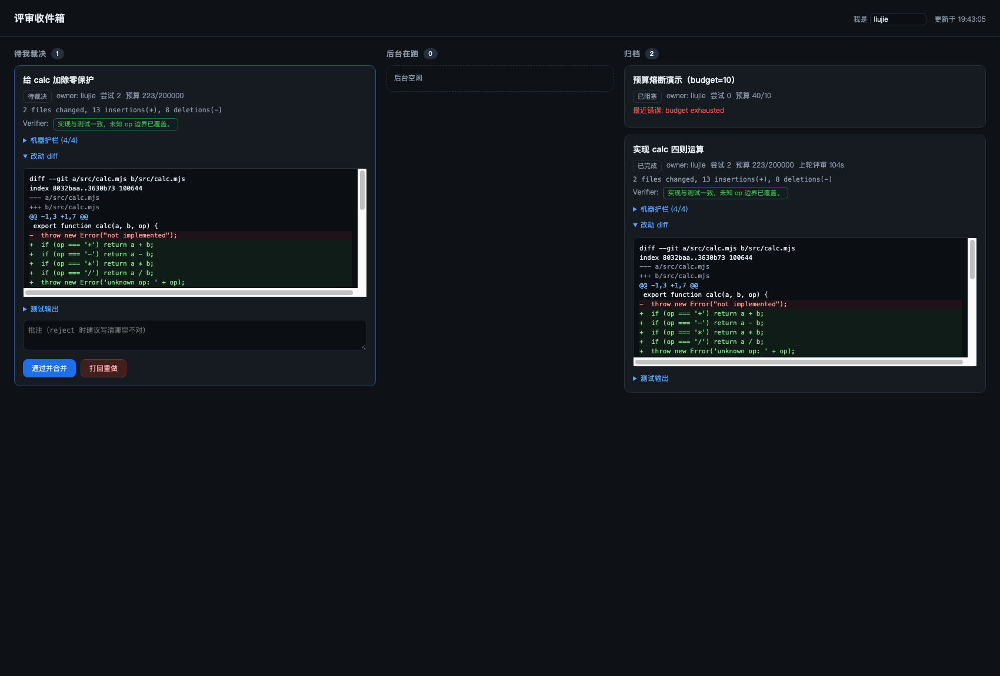

# 工作台 (Workbench) v0

一个「AI 团队分工写代码、人只负责 review」的后台执行器。
你提交任务 → 后台自动 规划/实现/验收/复核 → 卡在 `awaiting_human` 等你看一眼 → 你说合或不合。

人只回答一个问题：**要不要合**。其余全部自动重试、自动升级、自动归档。

## 30 秒跑起来

```bash
npm run init                 # 建账本 + 初始化 demo 仓库
npm run enqueue -- --title "实现 calc 四则运算" --repo ./sandbox/demo
npm run worker               # 另一个终端：后台一直跑（也可 --once 跑一轮）
npm run serve                # 打开 http://127.0.0.1:7317 审阅
```

默认引擎是 `mock`（确定性假引擎，用来验证流水线与护栏），不需要任何 API key、不花钱。



## 它凭什么能无人值守

五个「不信任模型」的设计，缺一个就会退化成值班员：

| 机制 | 解决的问题 | 落点 |
| --- | --- | --- |
| **事件账本**（events 唯一真源，tasks 是物化投影） | 重启失忆、状态对不上 | `src/core/ledger.mjs` 的 `rebuild()`，kill -9 后从事件重放 |
| **租约**（单条 CAS UPDATE + pid 存活探测） | 两个 worker 抢同一个任务、死进程占着不放 | `src/core/lease.mjs` |
| **确定性护栏**（跑真测试、比对测试用例/断言数、查同义反复测试、diff 规模） | agent 改测试刷绿、空断言、**把实现抄成期望值**、顺手重构半个仓库 | `src/runner/guards.mjs` |
| **角色分离**（Verifier 拿不到 coder 的内心独白，只给 diff+真实测试输出+护栏结论） | 自己批自己的作业 | `src/runner/sop.mjs` |

「测试跑绿 ≠ 改对了」这件事，是护栏里的 `no_test_weakening` 与 `no_tautological_test` 兜住的，不是模型自评：

- **削弱测试**：删文件、用例数/断言数变少 → 打回。
- **同义反复**：实现是 `return Math.pow(a,b)`，测试写 `assert.equal(pow(2,0.5), Math.pow(2,0.5))` —— 永远绿，因为它校验的是"实现等于实现"。
  这条是真实基准跑出来的：Verifier 靠判断发现了它，现在下沉成确定性检查（`src/runner/guards.mjs` 的 `tautologyIn`），不再依赖模型有没有注意到。

伪绿会被自动打回重做，重试到上限才升级给人。重试这条路踩过两个坑，都已经堵上：

- **不喂证据 = 无脑重试**：现在把上一轮失败的护栏 id、证据原文、Verifier 上抛点一起写进 Coder 的提示词（`retryFeedback`）。
- **不重置 worktree = 假装重试**：第二次进入 `implementing` 时先 `git reset --hard` 回基线（`resetToBase`）。
  不重置的话 Coder 看到的是上一轮已经写好的代码，会"发现活干完了"，产出逐字节相同的 diff，白烧一整轮 token——真实基准里就是这么翻的车。
- **预算要给验证留钱**：实现花 18 万写完、账上没钱再跑 Verifier，等于把钱和活一起扔掉。现在进实现前先检查余量（`reserveShort`，默认留 25% 或 15 万 token）。

## 状态机

```
queued → planning → implementing → verifying → reviewing → awaiting_human → merging → done
              ↑           │            │            │              │           │
              └───────────┴────────────┴────────────┘              │           │
                         （自动重试，最多 3 轮）        blocked ←────┘           │
                                                          └── failed ───────────┘
```

- 只有 `awaiting_human` 会停住等人，且只有任务的 `owner` 能裁决（多人协作时防止「以为别人在看」）。
- `blocked` 是「机器认输了」：重试耗尽或预算超限，等人捞。

## 命令

```bash
node src/cli.mjs init                              # 建库 + 建 demo 仓库
node src/cli.mjs enqueue --title "..." --repo <dir> [--owner <name>] [--budget 1000000]
node src/cli.mjs status [--id <task>]              # 看任务与事件流
node src/cli.mjs rebuild                           # 从事件全量重建投影（自愈）
node src/cli.mjs run [--once] [--worker host:pid]  # 跑 worker
node src/cli.mjs serve [--port 7317]               # 起审阅服务
npm run demo:reset                                 # 把 sandbox/demo 恢复到种子状态
npm test                                           # 内核测试（状态机/账本/租约/预算/护栏）
```

## 环境变量

| 变量 | 默认 | 说明 |
| --- | --- | --- |
| `WB_ENGINE` | `mock` | `mock` 假引擎；`opencode` 真引擎（调本机 opencode CLI） |
| `WB_DB` | `data/ledger.db` | 账本路径 |
| `WB_TOKEN` | 空 | 设了就要带 `Authorization: Bearer <token>` |
| `WB_PORT` / `WB_HOST` | `7317` / `127.0.0.1` | 服务监听（多人用时改 `0.0.0.0`） |
| `WB_MAX_ATTEMPTS` | `3` | 自动重试上限，超过转 `blocked` |
| `WB_MOCK_DELAY` | `0` | mock 每步延迟，用来模拟慢任务/演示并发 |
| `WB_MOCK_SCENARIO` | `fakegreen` | mock 场景：`fakegreen` 第一轮故意刷绿、`good` 一次过 |
| `WB_MODEL` | 空 | opencode 用的模型 |
| `WB_OC_HOME` | `./.oc` | opencode 的 XDG 数据目录（见下节：它必须能写，否则直接崩） |
| `WB_BUDGET` | `1000000` | 单任务 token 预算；真引擎一个任务约 36–48 万，20 万会中途熔断 |

## 五条验收怎么复现

1. **人工决策中位耗时 < 5 分钟** —— 卡片上直接给 diff / 护栏明细 / Verifier 结论 / 上抛问题，`review_seconds` 落库统计。
2. **照妖镜**：`npm test` 里「护栏：伪绿…」用例即此项；真管线里第一轮会被 `no_test_weakening` 打回。
3. **kill -9 自愈**：跑 `npm run worker` 中途 `kill -9`，再跑 `node src/cli.mjs run --once`，任务从断点续跑且不重复烧重试额度（事件流会出现 `attempt.resumed`）。
4. **并发**：两个 worker 起在同一账本上，同一个任务只会有一次 `lease.acquired`；不同任务各自独立 git worktree。
5. **预算熔断**：`--budget 10` 入队，跑一轮即 `blocked`，不会再花 token。

## 真引擎（方案 1）

`WB_ENGINE=opencode` 时，每个角色都起一次独立的 `opencode run`（不 `--continue`），
所以 Verifier 天然拿不到 Coder 的上下文——角色分离不是靠提示词约束，是靠进程隔离。

2026-11-18 在本机实测踩到的三个坑，provider 里已经全部兜住（`src/runner/providers/opencode.mjs`）：

| 坑 | 现象 | 兜法 |
| --- | --- | --- |
| 要写 `~/.local/share/opencode` | `attempt to write a readonly database`，沙箱里必崩 | 把 `XDG_DATA_HOME/CACHE/STATE` 指到工作区内的 `WB_OC_HOME`（默认 `./.oc`） |
| 报错时**不退出** | 实测挂 13 分钟、stdout 0 字节，stdout 一个字的错误都不给 | 盯它自己的日志文件（`${XDG_DATA_HOME}/opencode/log/*.log`），命中限流/额度/鉴权字样立刻 SIGKILL |
| 空产出但 exit 0 | 看起来"干完了"，其实什么都没做 | 文本为空即判失败，绝不当成功 |

两个体检命令，都是几秒钟出结论：

```bash
# 1) 引擎能不能用（不能用时直接告诉你原因，不会挂在那儿）
WB_ENGINE=opencode WB_MODEL=<provider/model> node scripts/engine-smoke.mjs "只回复两个字 OK"

# 2) 真任务基准：失败率 / 耗时 / token / 重试次数，报告写到 docs/bench-*.json
WB_ENGINE=opencode WB_MODEL=<provider/model> node scripts/bench.mjs --fresh --tasks 3
```

基准用的是独立种子仓库 `.bench/repo`（不是 `sandbox/demo`），所以跑来跑去不会污染演示数据。

### 实测基准（2026-11-18，gpt-agent.cc + deepseek-v4.1-flash）

```
任务                       状态             尝试  token      秒  校验
slugify    awaiting_human      1   410511   110 pass
pow        awaiting_human      1   362124   201 pass
divzero    awaiting_human      1   477178   311 pass

成功率 1  到达人工审核 3/3  重试 0  总 token 1249813  墙钟 311s
```

三件事值得记住：

1. **一次过**：3/3 第一轮就过护栏 + Verifier，0 次重试，没有伪绿。照妖镜这次没被触发（不是没生效，是模型没作弊）。
2. **单任务 ≈ 36–48 万 token**（约 100 秒）。这是真引擎的成本量级，不是提示词里能省掉的：opencode 每次调用自带 2 万 token 的系统提示 + 工具往返。
   所以默认预算从 20 万提到了 **100 万**（`WB_BUDGET`）——20 万是 mock 时代的数，真任务会在跑到一半时熔断。
3. **Verifier 确实在判内容，不在判格式**：它自己上抛了「`pow` 的测试与实现同为 `Math.pow`，属同义反复」、
   「`calc(0,0,'/')` 现在也抛错，但数学上是 NaN」、「非 ASCII 字母会被当分隔符」——这三条都不是测试能测出来的。

人工闭环也验过：approve → `merging` → `git merge --no-ff` → `done`，demo 仓库出现合并提交 `wb: merge 实现 src/slug.mjs ...`。

## v0 不做什么（故意的）

- 不做多人实时协作（多租户 = 5 倍工作量）；多人场景先用「一台 Mac 当 runner + 内网 + 单 token」，owner 绑唯一 reviewer。
- 不做苹果签名/上架（无法自动化，闭环终点是测试通过 + 可归档产物）。
- 不做富 UI 编辑，不做代码内联批注，只有「合 / 不合 + 一句话理由」。

## 目录

```
src/core/     账本、事件、状态机、租约
src/runner/   worker 循环、SOP 提示词、护栏、worktree、引擎 provider
src/server/   HTTP + 静态审阅界面
web/          审阅收件箱（三栏：待裁决 / 后台在跑 / 归档）
sandbox/demo/ 演示用目标仓库（有真测试，能真跑）
tests/        内核测试
scripts/      demo 重置、引擎体检（engine-smoke）、真引擎基准（bench）
```